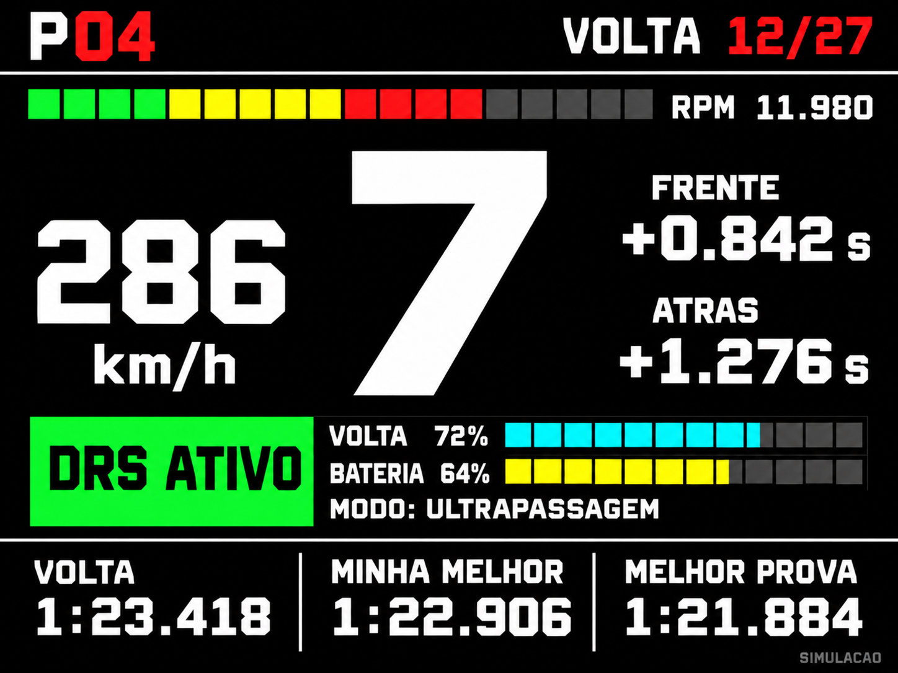
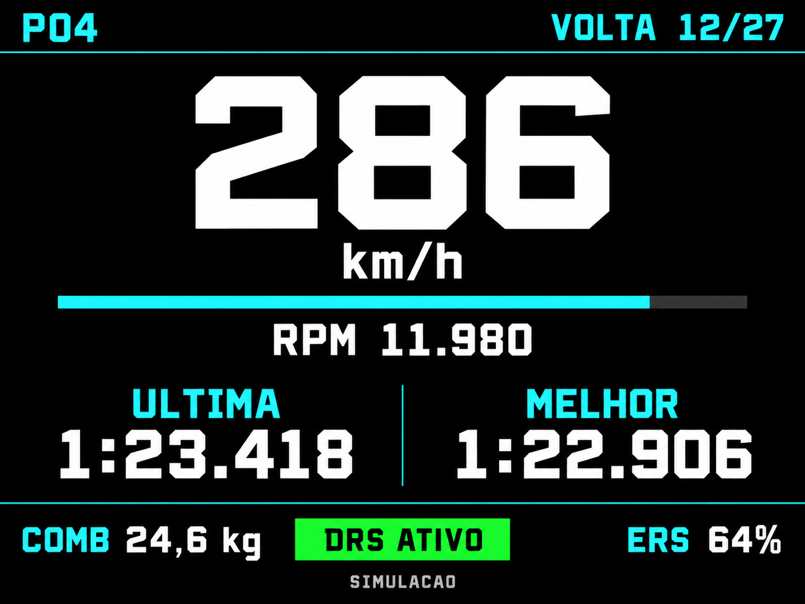
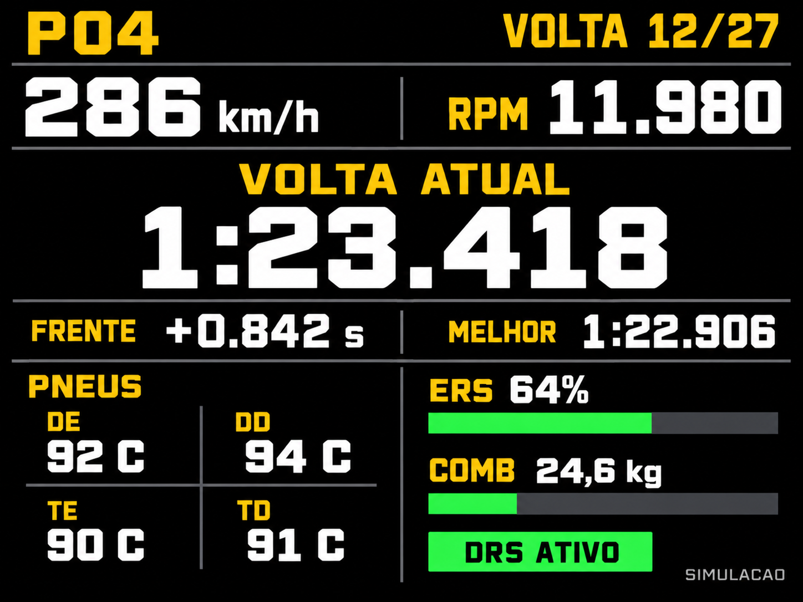

# Propostas visuais do dashboard

Estudo de layout para a TFT de 320×240 em orientação horizontal. As imagens
são conceitos gerados com a ferramenta integrada imagegen, com valores
simulados; não são capturas do firmware nem provas de legibilidade em 320×240.
A tipografia e os espaçamentos serão ajustados na implementação física.

## Corrida central

Proposta escolhida. A revisão abaixo incorpora as mudanças solicitadas:

Marcha grande no centro, velocidade à esquerda e intervalos à direita.
RPM com cores progressivas; DRS acompanhado de duas barras de energia e
modo do ERS. Rodapé com volta atual, melhor pessoal e melhor da prova.
Veja [distribuição e significado dos campos](Dashboard_Corrida.md).
O [primeiro estudo](corrida-central.png) foi preservado.

Essa opção atende ao pedido de mostrar a marcha na própria TFT. O uso do
display separado de sete segmentos passou a ser opcional e ainda será decidido.

## Velocidade limpa

Velocidade como elemento principal, com RPM, tempos, combustível e ERS.
Essa alternativa não reserva espaço para a marcha na TFT e combina com
o display separado, se ele for adotado.

## Ritmo e pneus

Tempo de volta em destaque, intervalo para o carro da frente, melhor volta,
temperaturas dos quatro pneus e barras de ERS/combustível. Pode ser uma
página de consulta, mantendo uma página principal mais simples para dirigir.

## Dados e implementação

O dashboard escolhido está implementado, conforme
[Dashboard no ESP32](../Dashboard_Firmware.md). A leitura usa estes pacotes:

| Pacote | Aplicação nos conceitos |
| --- | --- |
| 6 — Telemetria | DRS ativado e temperaturas, além dos campos atuais. |
| 7 — Estado do carro | Combustível, energia ERS e permissão de DRS. |
| 2 — Voltas | Posição, volta atual, tempo atual/anterior e intervalo à frente. |
| 1 — Sessão | Quantidade total de voltas. |
| 11 — Histórico | Melhor volta e setores válidos. |

`DRS ATIVO` corresponde à asa aberta, informada por `m_drs`. O indicador
de disponibilidade vem de `m_drsAllowed`; são estados diferentes. A barra
verde representa um estado, não uma porcentagem de abertura.

A lista geral de dados ficou guardada em [Telemetria F1 25](../Telemetria_F1_25.md).
A energia ERS chega em joules: a exibição em porcentagem precisa de uma
conversão adequada ao carro/regulamento. Combustível deve ter unidade clara
e escala coerente. Temperatura dos pneus, desgaste e dano são medidas distintas.

Para alertas, pode-se priorizar bandeiras, limite de velocidade nos boxes,
volta inválida e ausência de telemetria. Gráficos de evolução e análises de
sessão podem ficar no futuro backend, aproveitando a tela maior do navegador.

Os prompts usados estão em [Prompts.md](Prompts.md). As imagens são estudos
visuais; a implementação física usa fontes e espaçamentos adaptados à TFT.

## Referências

- [EA: estruturas oficiais UDP F1 25, formato 2025](https://forums.ea.com/t5/s/tghpe58374/attachments/tghpe58374/f1-games-game-info-hub-en/61/5/F1%2025%20Telemetry%20Output%20Structures.txt)
- [EA: especificação completa](https://forums.ea.com/t5/s/tghpe58374/attachments/tghpe58374/f1-games-game-info-hub-en/61/4/Data%20Output%20from%20F1%2025%20v3.pdf)
